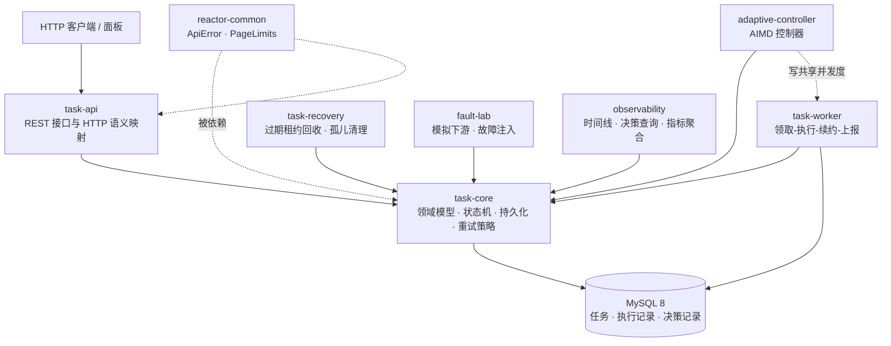

<div align="center">

# YukiReactor

**基于 MySQL 的分布式异步任务执行引擎**

任务在异常条件下的行为，比任务能不能跑起来更值得设计。

[](https://openjdk.org/projects/jdk/21/)
[](https://spring.io/projects/spring-boot)
[](https://www.mysql.com/)
[](https://testcontainers.com/)
[](LICENSE)

[架构](#架构) · [核心设计](#核心设计) · [快速开始](#快速开始) · [API](#rest-api) · [测试](#测试)

</div>

---

## 这个项目解决什么

多数任务队列的默认假设是「执行器活着」。一旦执行器崩溃、下游过载或网络抖动，任务就停在中间态：既不在跑，也不是成功，而且没人知道该由谁接手。

YukiReactor 把这几件事当成核心问题来设计：

| 问题 | 做法 |
|---|---|
| 多个实例同时抢到同一个任务 | 领取走条件 UPDATE，受影响行数必须为 1 |
| 崩溃前的执行者迟到提交，覆盖别人的结果 | 每次领取递增 `fencing_token`，提交时校验，过期写入被拒并留痕 |
| 执行器被强杀，任务卡在 `RUNNING` | 租约 + 心跳续约；过期租约被扫描器回收并重新派发 |
| 下游过载时仍在加码 | AIMD 并发控制，越界快降、健康慢升 |
| 出了问题说不清为什么 | 每次调整与延迟都写 `scheduler_decision`，带原因码与当时的指标 |

**MySQL 是唯一任务状态来源**，不依赖 Redis 或消息队列。状态与执行权同源，避免两个真相之间的一致性窗口。

## 架构



`task-worker`、`task-recovery`、`adaptive-controller` 可各自独立进程运行。控制器与 worker 不直接调用：控制器写、worker 读同一个共享并发度，观测信号经 `RuntimeSignals` 传递。

## 核心设计

### 领取：条件 UPDATE，受影响行数必须为 1

```sql
UPDATE task
   SET status = 'RUNNING', lease_owner = ?, lease_until = ?,
       fencing_token = fencing_token + 1, attempt_count = attempt_count + 1
 WHERE id = ? AND status IN ('PENDING', 'RETRY_WAIT') AND next_run_at <= NOW(3)
```

多个 worker 竞争同一任务时，只有一方拿到 1 行；其余读到 0 行自然放弃，不需要分布式锁。

### 提交：fencing token 拒绝迟到写入

```sql
UPDATE task
   SET status = ?, ...
 WHERE id = ? AND status = 'RUNNING' AND fencing_token = ?
```

执行器超时后任务可能已被回收并重新派发给别的实例。原执行者迟到的结果因为 token 不匹配被拒绝，执行记录关闭为 `ABANDONED` + `STALE_WRITER`，**不会覆盖已确认的状态**。

> 边界：fencing token 只能阻止写入，不能撤销已经发生的外部副作用。对外部调用仍需业务幂等键或目标系统去重。

### 恢复：租约 TTL 决定恢复上界

执行期间按 `lease-renew-interval` 续约。持有者被强杀后停止续约，`lease_until` 到期，扫描器确认状态与 token 未变才回收为 `RETRY_WAIT`。恢复耗时近似等于 TTL，这也是 `lease-ttl` 成为关键调优参数的原因。

### 自适应：AIMD 与可解释性

并发度调整遵循「越界快降、健康慢升」，并带四个约束：

- **连续越界才降**，避免单点抖动触发振荡
- **冷却期**内不重复调整
- **上调前需要完整健康观察窗**，每次成功上调都重新计时
- **指标缺失或不可读时回退保守并发度**，不把「未知」当「健康」

每次调整写一行 `scheduler_decision`，包含原因码（`DOWNSTREAM_OVERLOAD`、`METRICS_UNAVAILABLE`、`RECOVERY_OBSERVED` 等）、调整前后值与当时的指标快照。

## 快速开始

前置：**JDK 21**、**Docker**（用于 MySQL）、Maven Wrapper 已随仓库提供。

```powershell
# 1. 启动 MySQL 8（库 reactor，用户 reactor / reactor123）
docker compose up -d mysql

# 2. 启动应用
$env:JAVA_HOME="$env:USERPROFILE\.jdks\jdk-21.0.12.1+1"
.\mvnw.cmd -pl app -am spring-boot:run
```

或用 Docker Compose 一起部署应用与数据库（镜像内编译，Flyway 启动时自动迁移）：

```powershell
docker compose up -d --build
```

提交一个任务并观察执行：

```powershell
# 提交（200ms 后成功）
curl.exe -s -X POST http://localhost:8080/api/v1/tasks `
  -H "Content-Type: application/json" `
  -d '{"taskType":"echo","payload":{"sleepMs":200},"idempotencyScope":"demo","idempotencyKey":"order-1"}'

# 查询状态：提交成功只代表任务被接受并持久化，不代表执行成功
curl.exe -s http://localhost:8080/api/v1/tasks/1

# 查看每次执行的记录
curl.exe -s http://localhost:8080/api/v1/tasks/1/executions
```

## REST API

所有路径以 `/api/v1` 开头，错误响应统一为 `{"code": "...", "message": "..."}`。

| 方法 | 路径 | 说明 |
|---|---|---|
| `POST` | `/tasks` | 提交任务。新建 `201`，命中幂等键 `200`（`idempotentReplay=true`） |
| `GET` | `/tasks/{id}` | 任务详情 |
| `GET` | `/tasks` | 分页查询：`status`、`from`/`to`、`page`、`size`（1–200） |
| `GET` | `/tasks/{id}/executions` | 执行历史：每次尝试的结果、错误码、fencing token |
| `POST` | `/tasks/{id}/cancel` | 取消尚未开始的任务（ADMIN） |
| `POST` | `/tasks/{id}/replay` | 重放失败任务（ADMIN） |
| `GET` | `/tasks/{id}/timeline` | 任务时间线：状态变更、执行尝试与调度决策合并为可读序列 |
| `GET` | `/decisions` | 决策查询：`taskId`、`type`、`reasonCode`、`from`/`to` |
| `GET` | `/metrics/summary` | 指标聚合：完成数、失败率、吞吐、队列与执行延迟、积压与在飞 |
| `POST` | `/experiments` | 记录一轮对照实验，同名同策略同轮次重复返回 `409` |
| `GET` | `/experiments/{name}` | 某实验名的全部轮次 |

静态面板在 `http://localhost:8080/panel/index.html`，无构建步骤，直接调用上述接口。

管理写操作（取消、重放、故障注入）需要 HTTP Basic 且具备 `ADMIN` 角色；读取接口、面板与 actuator 保持开放。密码经环境变量 `REACTOR_ADMIN_PASSWORD` 注入，缺省值 `reactor-dev` 仅本机开发可用。

<details>
<summary>错误码一览</summary>

`TASK_NOT_FOUND`(404)、`UNKNOWN_TASK_TYPE`(400)、`INVALID_REQUEST`(400)、`ILLEGAL_TASK_TRANSITION`(409)、`INVALID_TASK_STATE`(409)、`IDEMPOTENCY_CONFLICT`(409)、`DUPLICATE_EXPERIMENT_ROUND`(409)、`UNAUTHORIZED`(401)、`FORBIDDEN`(403)、`INTERNAL_ERROR`(500)

</details>

## 任务状态机

```
PENDING → RUNNING → SUCCEEDED
   │         ├─────→ RETRY_WAIT → RUNNING   （到达下次执行时间后重新领取）
   │         └─────→ FAILED → PENDING       （仅管理员重放）
   └─────→ CANCELLED                        （仅限尚未开始的任务）
```

所有状态变更先经状态机校验，再执行带条件 UPDATE。领取时立即插入执行记录，保证执行器崩溃也留有痕迹。执行器失联不会被推导为成功——只有执行者提交成功结果才进入 `SUCCEEDED`。

超时是**协作式中断**：不响应中断的处理器会继续运行，其迟到结果被 fencing token 拒绝。`RUNNING → CANCELLED` 不是合法自动转换，执行中的取消只表示「请求取消」。

## 扩展任务类型

实现 `TaskHandler` 并注册为 Spring Bean，不需要修改调度核心代码：

```java
@Component
public class ReportTaskHandler implements TaskHandler {

    @Override
    public String taskType() {
        return "report";           // 未注册的类型提交时直接 400
    }

    @Override
    public void execute(TaskContext context) throws Exception {
        JsonNode payload = context.payload();
        // 失败时按可重试性抛对应异常（均在 com.yuki.reactor.core.error 下）：
        //   TransientTaskException          可重试
        //   ThrottledTaskException          可重试，且遵守下游给出的 retryAfter
        //   PermanentTaskException          不可重试
        //   InvalidTaskParameterException   不可重试
        // 未分类异常按 UNKNOWN 处理且可重试，仍受 maxAttempts 约束
    }
}
```

## 测试

```powershell
$env:JAVA_HOME="$env:USERPROFILE\.jdks\jdk-21.0.12.1+1"
.\mvnw.cmd -B verify
```

- **单元测试**（无需 Docker）：状态机全部合法与非法转换、退避计算含抖动边界、失败分类、AIMD 控制律、决策分页、时间线顺序、指标窗口口径。
- **集成测试**（Testcontainers + **真实 MySQL 8，不使用 H2**）：并发幂等提交、多引擎竞争的「恰好领取一次」、过期 fencing token 被拒、心跳续约阻止误回收、超时中断、重试派发限速、运行中改变并发度、管理端点认证与权限、HTTP 契约负路径，以及「副作用已产生但成功状态未写入」的故障窗口专项验证。

## 项目结构

```
reactor-common      统一错误体与分页边界（无内部依赖）
task-core           领域模型、状态机、失败分类与重试策略、MyBatis 映射
task-api            REST 接口与异常到 HTTP 语义的映射
task-worker         领取-执行-续约-上报的执行引擎
task-recovery       过期租约回收与孤儿执行记录清理
fault-lab           可运行时配置的模拟下游与故障注入
adaptive-controller AIMD 并发度控制器与决策记录
observability       任务时间线、决策查询、指标聚合与静态面板
app                 Spring Boot 装配与配置
```

## 配置

关键配置项在 `app/src/main/resources/application.yml`，各模块的 `@ConfigurationProperties` 类中有逐项注释。数据库连接可用 `MYSQL_HOST`、`MYSQL_PORT`、`MYSQL_DATABASE`、`MYSQL_USER`、`MYSQL_PASSWORD` 覆盖。

## 已知局限

- 状态存储单点依赖 MySQL，没有做分库分表；任务量继续增长时领取语句需要重新评估。
- 运行时信号使用固定样本窗口，故障期样本会保留到恢复初期，导致自适应爬坡偏慢。
- 超时是协作式中断，不响应中断的处理器无法被强制停止，只能靠 fencing token 拒绝其结果。
- 决策记录只写不改，没有归档与清理策略。

## License

[MIT](LICENSE) © 2026 ShigureYukina
